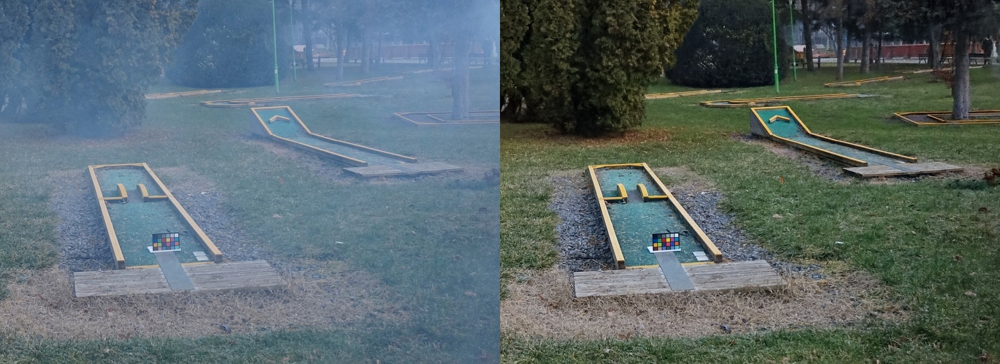
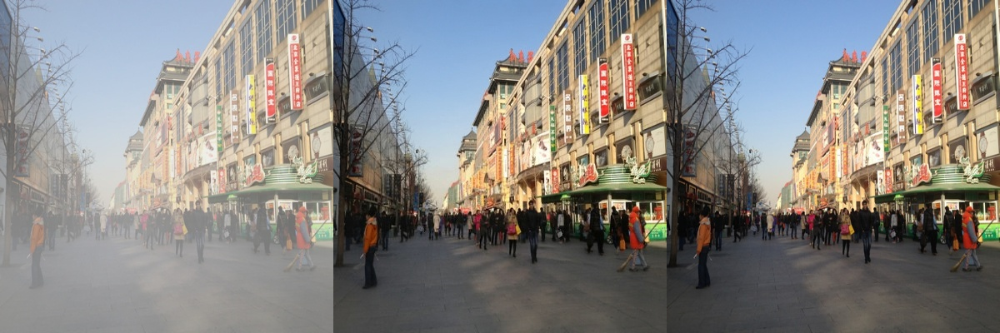

# Fog Removal: real-time fog detection and dehazing for live video on a Raspberry Pi

This project takes foggy images or live camera video, detects how foggy each frame is, and removes the fog to give
a clear image. Models are trained on a PC GPU, exported to ONNX, and run on a Raspberry Pi with a camera.


*Real foggy photo: input (left), output of the pretrained DehazeFormer-MCT in this repo (right).*


*RESIDE benchmark image: hazy input, model output, true clear image.*

## Contents

| Folder | What it is | Use it for |
|---|---|---|
| [`gunet_dehaze/`](gunet_dehaze/) | **Main model**: [gUNet](https://github.com/IDKiro/gUNet) adapted for edge export, plus the **pretrained DehazeFormer-MCT** | Best quality. Runs on a PC GPU or a Pi 5 with the AI HAT+ |
| [`fognet_lite/`](fognet_lite/) | **FogNet-Lite**: our own tiny AOD-Net-style model (6.7k params) with a Dark Channel Prior fallback | Real time on a Raspberry Pi **CPU** |
| [`docs/images/`](docs/images/) | Example results | |

```
Fog_removal/
├── gunet_dehaze/
│   ├── fogdehaze/            model code (gUNet, DehazeFormer-MCT), data loader, utils
│   ├── scripts/              train, evaluate, infer (image/video/webcam), export_onnx, test_pretrained, ...
│   ├── configs/              training settings for laptop GPU / fine-tuning / Pi CPU
│   ├── pretrained/dehazeformer_demo/dehazeformer.pth   ready-to-use pretrained weights
│   └── samples/online/       6 real foggy photos for a quick test
├── fognet_lite/
│   ├── fognet/               model, training, synthetic fog, DCP, ONNX export
│   ├── pi_infer.py           Raspberry Pi camera / video inference (onnxruntime, no PyTorch)
│   ├── compare.py            PSNR / SSIM / speed table: input vs DCP vs FogNet-Lite vs gUNet
│   └── download_data.py      downloads RESIDE-6K, SOTS, NH-HAZE2 from Hugging Face
└── docs/images/
```

---

## 1. Install (training / test PC)

Requires Python 3.10+. An NVIDIA GPU is recommended for training, but you can run models on a CPU.

```bash
git clone https://github.com/ritik3041998/Fog_removal.git
cd Fog_removal

python -m venv venv
# Windows:  venv\Scripts\activate          Linux/macOS:  source venv/bin/activate

# PyTorch: pick the right command for your machine at https://pytorch.org/get-started/locally/
pip install torch torchvision --index-url https://download.pytorch.org/whl/cu126   # NVIDIA GPU
# pip install torch torchvision                                                    # CPU only

pip install -r gunet_dehaze/requirements.txt
pip install -r fognet_lite/requirements.txt
```

> **Windows + OneDrive:** create the venv and keep datasets **outside** OneDrive (for example
> `%USERPROFILE%\.venvs\fog` and `%USERPROFILE%\fogdata`). Otherwise OneDrive uploads several GB.

## 2. Run the pretrained model right now (no training needed)

Run every command in this section from inside `gunet_dehaze/`:

```bash
cd gunet_dehaze

# a) the 6 real foggy sample photos -> side-by-side results in results/demo/
python scripts/infer.py --weights pretrained/dehazeformer_demo/dehazeformer.pth --source samples/online --out results/demo

# b) your own photo or a folder of photos
python scripts/infer.py --weights pretrained/dehazeformer_demo/dehazeformer.pth --source path/to/foggy.jpg --out results/mine

# c) a foggy video -> dehazed side-by-side video
python scripts/infer.py --weights pretrained/dehazeformer_demo/dehazeformer.pth --source foggy.mp4 --out clear.mp4

# d) live webcam (camera 0): window shows input | dehazed, fog score and FPS
python scripts/infer.py --weights pretrained/dehazeformer_demo/dehazeformer.pth --source 0
```

Keys in the live window: **q** quits, **space** pauses, **d** toggles dehazing on or off.
`--fog-threshold 0.3` dehazes only frames whose fog score is at least 0.3. That is the **fog detection** part:
a dark-channel haze score from 0 (clear) upwards, shown on every frame.

Measured on an RTX 3050 laptop GPU: about 140 ms per frame. On the laptop CPU it takes about 2 s per 640x480 frame.
DehazeFormer-MCT is the quality reference. For live video on the Pi, use the models below.

## 3. Get the datasets

```bash
cd fognet_lite
pip install huggingface_hub pyarrow
python download_data.py --root %USERPROFILE%/fogdata        # Windows  (~2 GB)
python download_data.py --root ~/fogdata                    # Linux/macOS
```

| Dataset | Path (under `fogdata/`) | Pairs | Use |
|---|---|---|---|
| RESIDE-6K | `RESIDE-6K/train/{hazy,GT}` | 6000 | training |
| SOTS outdoor | `SOTS/SOTS/outdoor/{hazy,gt}` | 500 | standard test benchmark |
| SOTS indoor | `SOTS/SOTS/indoor/{hazy,gt}` | 500 | test |
| NH-HAZE2 | `NH-HAZE2/data/train_notest/{hazy,clean}` | 70 | **real** haze (1600x1200) |

NH-HAZE2's 10 test images are byte-identical copies of 10 of its training images. Train on `train_notest` and
test on `test`.

Your own camera: record clear footage and generate matching foggy versions:
```bash
cd gunet_dehaze
python scripts/make_synthetic_fog.py --src my_clear_video.mp4 --every 15 --out ~/fogdata/mycam --depth midas
```

## 4. Train the main model (gUNet)

Run from `gunet_dehaze/`. Training takes about 4 hours for 100 epochs on an RTX 3050 (6 GB):

```bash
python scripts/train.py --config configs/gunet_t_laptop.json \
    --train-dir ~/fogdata/RESIDE-6K/train --val-dir ~/fogdata/SOTS/SOTS/outdoor --out runs/gunet_t

python scripts/train.py --config configs/gunet_t_laptop.json --out runs/gunet_t --resume   # continue after a stop
tensorboard --logdir runs                                                                 # loss / PSNR curves
```

| Config | Model | For |
|---|---|---|
| `gunet_t_laptop.json` | gUNet-T, 0.85M params, zero padding | main model, Pi 5 + AI HAT+ |
| `gunet_n_pi_cpu.json` | gUNet-N, 0.28M params | Pi CPU without accelerator |
| `gunet_t_finetune.json` | fine-tune with a low learning rate (`--init` a checkpoint) | adapting to your camera data |

Change any setting with `--set key=value`, for example `--set batch_size=8 epochs=50` if the GPU runs out of memory.

## 5. Test and compare

```bash
cd gunet_dehaze
python scripts/evaluate.py --ckpt runs/gunet_t/best.pth --data ~/fogdata/SOTS/SOTS/outdoor --save-dir results/sots
python scripts/test_pretrained.py --pairs ~/fogdata/SOTS/SOTS/outdoor --limit 200                       # DehazeFormer-MCT
python scripts/test_pretrained.py --model gunet --ckpt runs/gunet_t/best.pth --pairs ~/fogdata/SOTS/SOTS/outdoor

cd ../fognet_lite
python compare.py --hazy ~/fogdata/SOTS/SOTS/outdoor/hazy --clear ~/fogdata/SOTS/SOTS/outdoor/gt \
                  --model fognet.onnx --external ../gunet_dehaze/results/sots --samples 6
```

Results so far (pretrained DehazeFormer-MCT, 200 RESIDE-6K pairs): hazy input **15.29 dB**, output
**27.71 dB PSNR / 0.919 SSIM**. This may be optimistic because the model's training mix may contain RESIDE
images. SOTS-outdoor is the fair test.

## 6. Export and run on the Raspberry Pi

```bash
# on the PC
cd gunet_dehaze
python scripts/export_onnx.py --ckpt runs/gunet_t/best.pth --height 240 --width 320   # -> exports/gunet_t_240x320.onnx
```

On the Pi (64-bit Raspberry Pi OS; PyTorch is **not** needed):
```bash
pip install onnxruntime opencv-python numpy
# gUNet ONNX (copy gunet_dehaze/scripts/infer.py + gunet_dehaze/fogdehaze/ to the Pi)
python scripts/infer.py --weights gunet_t_240x320.onnx --source 0 --fog-threshold 0.3
# FogNet-Lite (fastest on the Pi CPU; supports the Pi Camera Module): see fognet_lite/README.md
python pi_infer.py --model fognet.onnx --source picam --show
```

**Recommended hardware:** Raspberry Pi 5 (8 GB), Raspberry Pi **AI HAT+** (Hailo-8, 26 TOPS) for gUNet,
Camera Module 3, the official 27 W USB-C power supply and the Active Cooler. For the AI HAT+, compile the
zero-padding gUNet ONNX to `.hef` with the Hailo Dataflow Compiler on an x86 Linux PC.

| Model | Params | Speed (measured on the dev PC) | Pi target |
|---|---|---|---|
| FogNet-Lite | 6.7k | 6 ms CPU @640x480 | Pi CPU, real time |
| gUNet-N | 0.28M | 511 ms CPU / 32 ms GPU @640x480 | Pi CPU at low resolution |
| gUNet-T | 0.85M | 842 ms CPU / 49 ms GPU @640x480 | Pi 5 + AI HAT+ |
| DehazeFormer-MCT (pretrained) | 1.23M | ~2 s CPU / 141 ms GPU @640x480 | PC only (quality reference) |

Pi speeds haven't been measured yet. Benchmark on the device.

More detail: [gunet_dehaze/README.md](gunet_dehaze/README.md) and [fognet_lite/README.md](fognet_lite/README.md).

## Credits and licenses

- gUNet: Song et al., *Rethinking Performance Gains in Image Dehazing Networks* (2022), [IDKiro/gUNet](https://github.com/IDKiro/gUNet), MIT.
- DehazeFormer / MCT: Song et al., *Vision Transformers for Single Image Dehazing* (2022),
  [IDKiro/DehazeFormer](https://github.com/IDKiro/DehazeFormer). The pretrained weights and sample photos come from the authors'
  [Hugging Face demo](https://huggingface.co/spaces/IDKiro/DehazeFormer_Demo), MIT.
- AOD-Net: Li et al., *An All-in-One Network for Dehazing and Beyond* (ICCV 2017), the basis of FogNet-Lite.
- Datasets: RESIDE (Li et al.), NH-HAZE2 (NTIRE 2021). See each dataset's own license.
